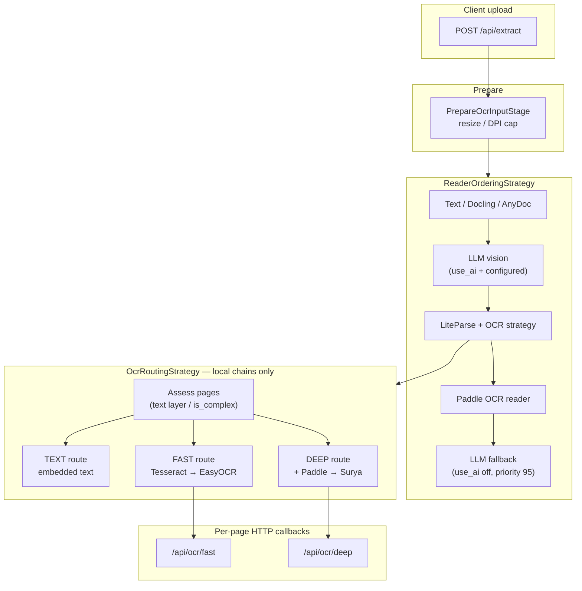
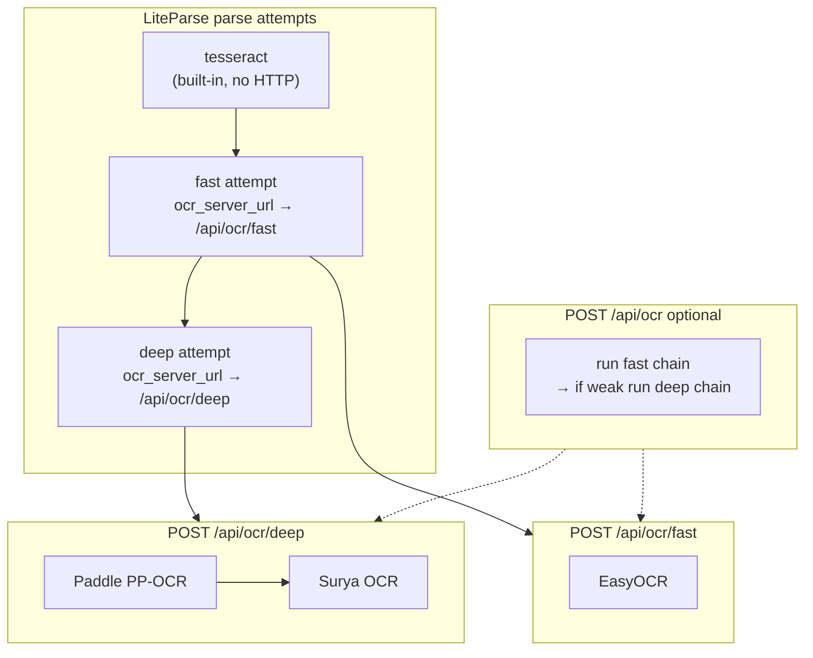

# Processing strategy layer

Server-side routing for **which reader runs first** and **which OCR chain runs per page**.
Clients upload via `POST /api/extract`; they do not pick backends.

## Layout

```
processing/strategy/
  reader/                    # Reader ordering (pipeline fallback order)
    base.py                  # ReaderOrderingStrategy ABC
    priority.py              # PriorityFallbackReaderOrdering
    llm.py                   # LLM vision readiness
  ocr/                       # Local OCR chains (LiteParse + HTTP callbacks)
    base.py                  # OcrRoutingStrategy ABC
    routing.py               # DefaultOcrRoutingStrategy
    assess.py                # Page-level OCR need
    chains.py                # Fast / deep chain runners
    liteparse_plan.py        # LiteParse parse attempts
    models.py                  # OcrPlan, OcrRoute, assessments
    quality.py                 # Weak-output heuristics
```

Legacy import paths `processing.decision` and `processing.ocr` re-export from here.

## End-to-end flow



## Reader order when `use_ai` is on

| Priority | Reader | Notes |
| --- | --- | --- |
| 5–10 | Text, Docling, AnyDoc | Native / office / structure toggles |
| **30** | **LLM** | `LLM_PRIORITY` — vision before local OCR |
| 35 | LiteParse | Layout + local OCR chains |
| 50 | OCR | Paddle PP-OCR / Structure fallback |
| 95 | LLM | `LLM_PRIORITY_FALLBACK` — inactive unless `can_process` |

## Reader order when `use_ai` is off

LLM is demoted to priority **95** (last). It stays inactive because `LLMReader.can_process` requires `use_ai`.

## Scaling

Add a new strategy by implementing the ABC and wiring it in the pipeline or LiteParse reader:

- `ReaderOrderingStrategy` — custom reader fallback order
- `OcrRoutingStrategy` — custom local OCR routing

Keep interfaces in `strategy/*/base.py`; implementations in separate modules.

## OCR callback HTTP API (`/api/ocr/fast`, `/api/ocr/deep`)

LiteParse calls these **per page image** when Tesseract is insufficient. Full reference:
[docs/ocr-callback-api.md](../../../docs/ocr-callback-api.md).



| Endpoint | Purpose | Backends |
| --- | --- | --- |
| `/api/ocr/fast` | Fast chain only | EasyOCR |
| `/api/ocr/deep` | Deep chain only | Paddle → Surya |
| `/api/ocr` | Auto-escalate per page | Fast then deep |

Clients use `POST /api/extract` only. These routes are internal LiteParse callbacks unless
you set `OCR_FAST_SERVER_URL` / `OCR_DEEP_SERVER_URL` to external microservices (default is local).
