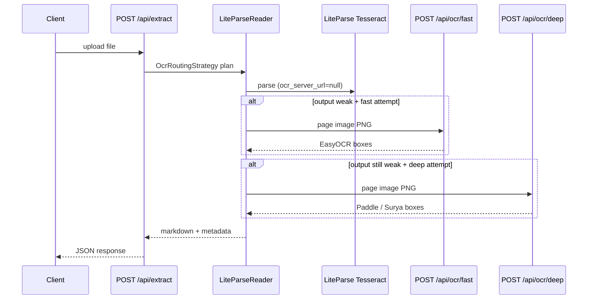

# LiteParse OCR callback API (`/api/ocr/*`)

Internal HTTP endpoints used by **LiteParse** when a page image needs OCR after Tesseract.
They are **not** the client upload path — users call `POST /api/extract`; the server
routes OCR via `processing.strategy`.

## Role in the pipeline



Tesseract runs **inside LiteParse** (no HTTP). Fast and deep chains run when
`DefaultOcrRoutingStrategy` adds `fast` / `deep` LiteParse attempts and output
is still weak.

## Endpoints

| Endpoint | Chain | Backends (server auto-picks) | Called by |
| --- | --- | --- | --- |
| `POST /api/ocr/fast` | **Fast** | EasyOCR | LiteParse `ocr_server_url` for `fast` attempt |
| `POST /api/ocr/deep` | **Deep** | Paddle PP-OCR → Surya | LiteParse `ocr_server_url` for `deep` attempt |
| `POST /api/ocr` | **Unified** | Fast chain, then deep if weak | Legacy / custom `LITEPARSE_OCR_SERVER_URL` |

All three implement the [LiteParse OCR HTTP API](https://github.com/run-llama/liteparse): one image per request, LiteParse-compatible JSON response.

### Not for clients

Do **not** call these from the frontend to “pick” an OCR engine. Use extract options
(`use_ai`, `prefer_structure`, `ocr_high_quality`) and server env toggles instead.

## Request

**Method:** `POST`

**Content-Type:** `multipart/form-data`

| Field | Type | Default | Description |
| --- | --- | --- | --- |
| `file` | file | required | Single page raster (PNG/JPEG/WebP, etc.) |
| `language` | string | `en` | OCR language hint (`en`, `eng`, `zh-cn`, …) |

## Response

**200 OK** — `LiteParseOcrResponse`

```json
{
  "results": [
    {
      "text": "Hello",
      "bbox": [10.0, 20.0, 80.0, 40.0],
      "confidence": 0.95,
      "polygon": [[10, 20], [80, 20], [80, 40], [10, 40]]
    }
  ]
}
```

| Field | Description |
| --- | --- |
| `text` | Recognized string |
| `bbox` | `[x1, y1, x2, y2]` axis-aligned box |
| `confidence` | Model score 0–1 |
| `polygon` | Optional quadrilateral (EasyOCR / Paddle may omit) |

## Chain behavior (server-side)

### Fast — `POST /api/ocr/fast`

```mermaid
flowchart LR
    IMG[Page image bytes] --> E["EasyOCR"]
    E --> OUT[results[]]
```

- Enabled: `EASYOCR_ENABLED=true` and `easyocr` package installed (`uv sync --extra liteparse`)
- Stops on first backend that passes quality heuristics; may return best weak result if all fail

### Deep — `POST /api/ocr/deep`

```mermaid
flowchart LR
    IMG[Page image bytes] --> P["Paddle PP-OCR"]
    P -->|weak| S["Surya OCR"]
    P --> OUT[results[]]
    S --> OUT
```

- Paddle: `LITEPARSE_USE_PADDLE_OCR=true` (PP-OCR only, not PP-StructureV3)
- Surya: `SURYA_ENABLED=true` and package wired (placeholder until extra is added)
- Same weak-output escalation as fast chain

### Unified — `POST /api/ocr`

Runs **fast** chain internally; if output is still weak, runs **deep** chain.
Used when `LITEPARSE_OCR_SERVER_URL` is unset and a single callback URL is needed,
or when pointing LiteParse at one auto-escalating endpoint.

## Errors

| Status | When |
| --- | --- |
| `400` | Empty `file` upload |
| `503` | No backends enabled, or all backends failed (`RuntimeError`) |
| `500` | Backend exception during inference |

## Configuration

### Callback URLs (LiteParse client → OCR service)

LiteParse **calls** these URLs; this API process **implements** the routes when URLs point local.
Point env vars at external microservices when you split OCR workers out.

| Env | Default (unset) | Purpose |
| --- | --- | --- |
| `OCR_FAST_SERVER_URL` | `http://127.0.0.1:{PORT}/api/ocr/fast` | LiteParse `fast` attempt |
| `OCR_DEEP_SERVER_URL` | `http://127.0.0.1:{PORT}/api/ocr/deep` | LiteParse `deep` attempt |
| `OCR_UNIFIED_SERVER_URL` | `http://127.0.0.1:{PORT}/api/ocr` | Single auto-escalating callback |
| `LITEPARSE_OCR_SERVER_URL` | — | Legacy alias for `OCR_UNIFIED_SERVER_URL` |
| `EASYOCR_OCR_SERVER_URL` | — | Legacy alias for `OCR_FAST_SERVER_URL` |

When `OCR_UNIFIED_SERVER_URL` or `LITEPARSE_OCR_SERVER_URL` is set, LiteParse uses **one**
custom URL and skips the fast/deep split.

**Microservice example:**

```bash
OCR_FAST_SERVER_URL=https://ocr-fast.internal/api/ocr/fast
OCR_DEEP_SERVER_URL=https://ocr-deep.internal/api/ocr/deep
```

Each service must implement the same LiteParse OCR request/response shape (this repo’s
`/api/ocr/fast` and `/api/ocr/deep` handlers are the reference implementation).

### Backend toggles

| Env | Affects |
| --- | --- |
| `EASYOCR_ENABLED` | Fast chain (local worker) |
| `EASYOCR_USE_GPU` | EasyOCR device |
| `LITEPARSE_USE_PADDLE_OCR` | Deep chain (Paddle) |
| `SURYA_ENABLED` | Deep chain (Surya) |
| `OCR_PLATFORM_MAX_INPUT_SIDE` | Input resize before Paddle (via prepare stage on extract) |

## URL resolution

| LiteParse attempt | `ocr_server_url` when env unset |
| --- | --- |
| `tesseract` | `null` (bundled Tesseract) |
| `fast` | `OCR_FAST_SERVER_URL` or local `/api/ocr/fast` |
| `deep` | `OCR_DEEP_SERVER_URL` or local `/api/ocr/deep` |
| `custom` | `OCR_UNIFIED_SERVER_URL` / `LITEPARSE_OCR_SERVER_URL` |

Resolved in `app.processing.strategy.ocr.chains` (`resolve_fast_ocr_server_url`, `resolve_deep_ocr_server_url`, `resolve_unified_ocr_server_url`).

## Related code

| Area | Path |
| --- | --- |
| Route handlers | `app/api/routes.py` |
| Chain runners | `app/processing/strategy/ocr/chains.py` |
| LiteParse attempts | `app/processing/strategy/ocr/liteparse_plan.py` |
| Routing strategy | `app/processing/strategy/ocr/routing.py` |
| Bridges | `app/services/easyocr_bridge.py`, `liteparse_ocr_bridge.py`, `surya_bridge.py` |
